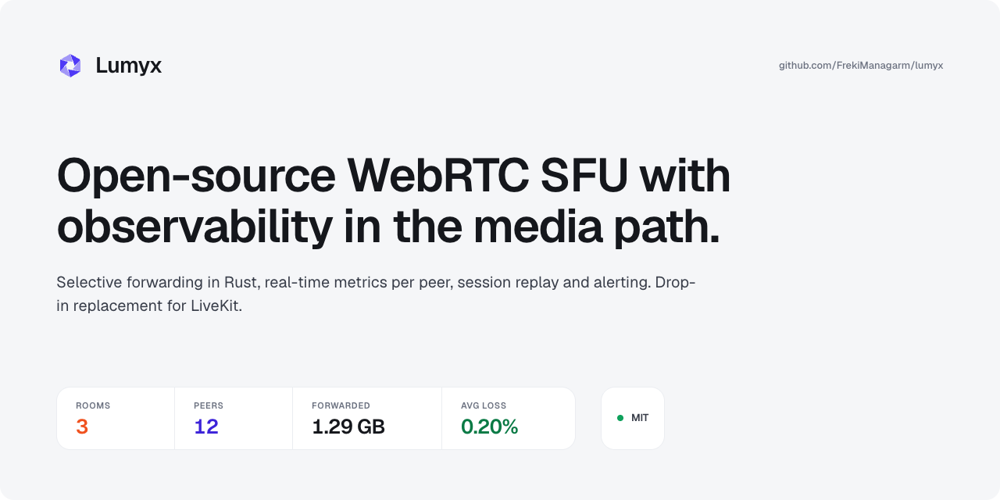

<p align="center">
  
</p>

# Lumyx website

The sources of [lumyx.dev](https://lumyx.dev) and [docs.lumyx.dev](https://docs.lumyx.dev) — the
public face of [Lumyx](https://github.com/lumyx-dev/sfu-core), an open-source WebRTC SFU in Rust
with native observability built in.

| Path | What it is | Dev URL |
|---|---|---|
| [`apps/landing`](apps/landing) | Marketing site — lumyx.dev | http://localhost:3000 |
| [`apps/docs`](apps/docs) | Documentation, built on [Fumadocs](https://fumadocs.dev) — docs.lumyx.dev | http://localhost:3003 |
| [`brand/`](brand) | Logos, avatars, social banners and Open Graph images | – |
| [`docs/`](docs) | Design notes for this repository | – |

Both apps use [`@lumyx/ui`](https://github.com/lumyx-dev/ui), the Lumyx design system.

## Getting started

You need [Bun](https://bun.com) and Node.js ≥ 22.18.

```bash
bun install
bun run dev            # both apps, through Turborepo
bun run dev --filter=@lumyx/docs
```

| Script | What it does |
|---|---|
| `bun run build` | Production build of both apps |
| `bun run lint` | ESLint |
| `bun run check-types` | TypeScript (and Fumadocs route types) |
| `bun run test` | Bun tests |
| `bun run verify:ds` | Design-system constraints |

Dependencies are hoisted to the root `node_modules` (`bunfig.toml`): the apps' Tailwind
`@source` directives rely on it.

`@lumyx/ui` is declared once, in the root `catalog`, as a GitHub tarball pinned to a commit —
bun's lockfile is not stable when two workspaces share a `github:` dependency. Bump the commit
SHA to update it; it becomes a plain npm version once `@lumyx/ui` is published.

### Environment variables

All optional — production values are set on Vercel.

| Variable | Used by | Default |
|---|---|---|
| `NEXT_PUBLIC_SITE_URL` | landing, docs | `https://lumyx.dev` |
| `NEXT_PUBLIC_DOCS_URL` | landing, docs | `https://docs.lumyx.dev` |
| `NEXT_PUBLIC_PLAUSIBLE_DOMAIN` | landing | `lumyx.dev` |
| `CLOUD_APP_URL` | landing | – |

## Contributing

Typos, broken links and unclear docs are welcome fixes — see the
[contribution guidelines](https://github.com/lumyx-dev/.github/blob/main/CONTRIBUTING.md).
Questions about the SFU itself belong in
[sfu-core Discussions](https://github.com/lumyx-dev/sfu-core/discussions).

## License

The code is [MIT](LICENSE) © Mathieu Chambaud. The Lumyx name, logo and the assets in
[`brand/`](brand) are not covered by the MIT license and may not be used to imply endorsement.

## Releasing

Versions follow [SemVer](https://semver.org/) and are cut from an up-to-date `main`:

```sh
npm version patch   # or minor / major
```

This runs the CI checks, bumps `package.json`, commits `chore(release): vX.Y.Z`, tags `vX.Y.Z`
and pushes. The tag triggers the Release workflow, which publishes a GitHub release with
generated notes.
